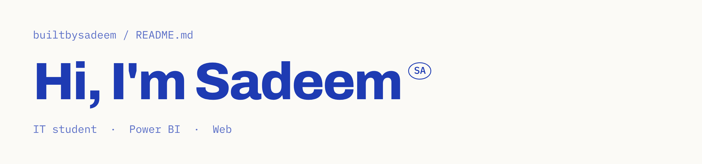

<picture>
  <source media="(prefers-color-scheme: dark)" srcset="assets/hi-dark.png">
  
</picture>

IT student who builds Power BI dashboards and simple, clean websites. This is where I experiment.

#### Skills

`Data analysis` `Dashboards` `SQL & databases` `UI/UX design` `Web development` `App development` `Agile & Scrum` `Networking`

#### Software

Built by Sadeem.
