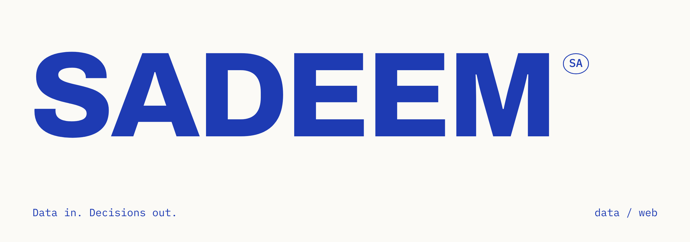
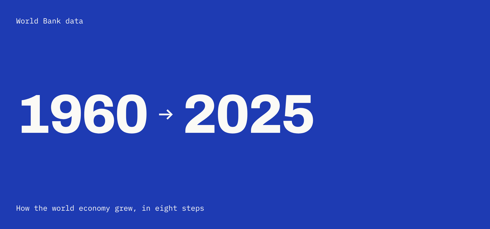

<picture>
  <source media="(prefers-color-scheme: dark)" srcset="assets/hero-dark.png">
  
</picture>

 

### About

I'm Sadeem, an IT graduate-to-be from Prince Mohammad Bin Fahd University in Khobar.
I build Power BI dashboards that turn messy data into clear answers, and websites that are simple to use.

 

### Work

**[Global GDP Atlas](https://sadeem.tech/work/global-gdp-atlas/)**\
How the world economy grew from 1960 to 2025, and who grew with it. World Bank GDP data for 217 economies, modelled in Power BI with about 30 DAX measures, turned into a three-page dashboard and an interactive website.

[Read the case study](https://sadeem.tech/work/global-gdp-atlas/) · [Visit the website](https://sadeem.tech/Global-GDP-Atlas/) · [Repository](https://github.com/builtbysadeem/Global-GDP-Atlas)

 

**Next up**

| | |
| :-- | --: |
| Laffa, a walking app | In progress |
| Hand tracking experiments: [particles](https://github.com/builtbysadeem/HandTrackingParticles), [pinch volume](https://github.com/builtbysadeem/pinch-volume-control) | In progress |

 

### Skills

**Data** — Power BI, SQL and databases, Data analysis, Python\
**Design and build** — UI/UX design, Figma, HTML, CSS and JavaScript, Web and app development, Java\
**Tools and process** — Git and GitHub, Agile and Scrum, Networking

 

### Contact

[sadeem.tech](https://sadeem.tech) · [LinkedIn](https://www.linkedin.com/in/sadeemhalzahrani) · [sadeem.connect@gmail.com](mailto:sadeem.connect@gmail.com)

 

Built by Sadeem.
